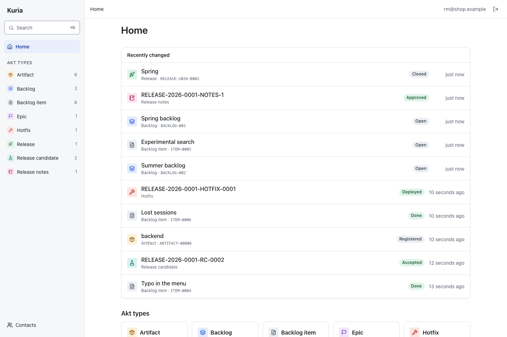
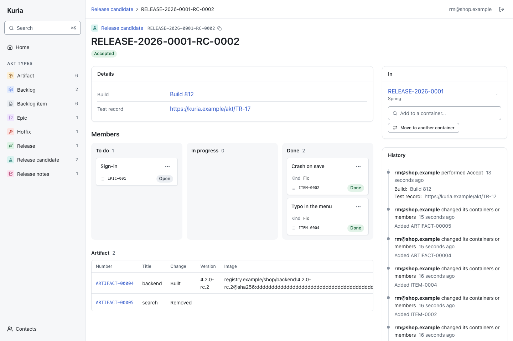
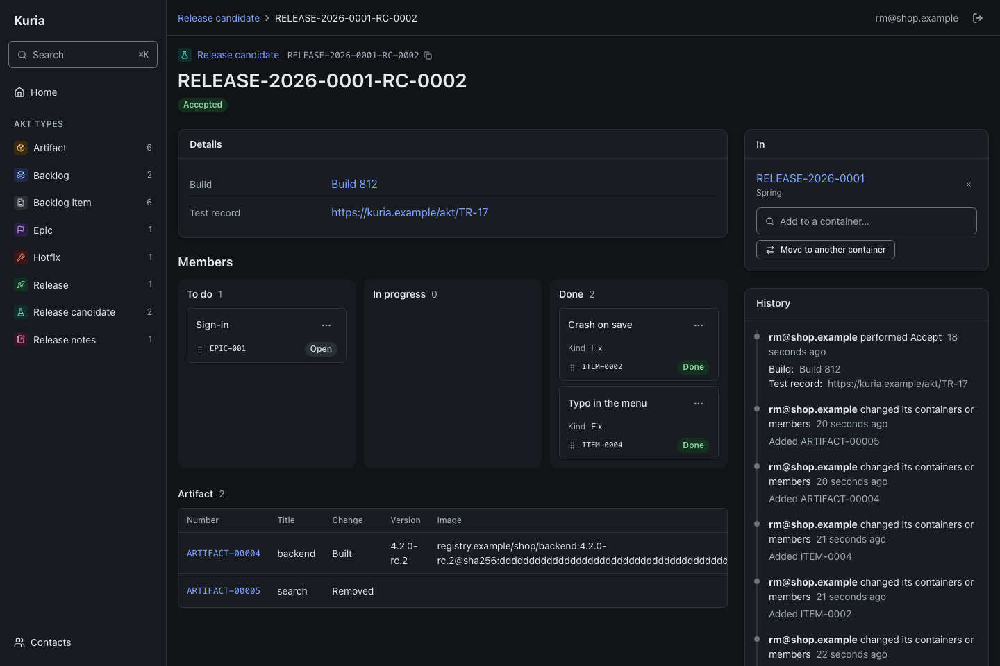
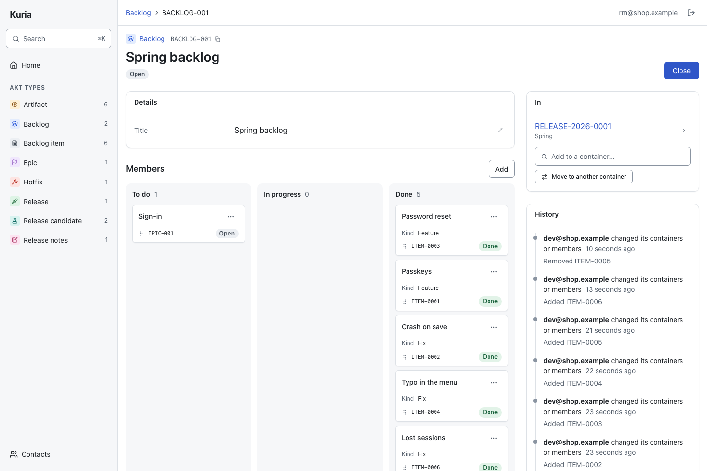
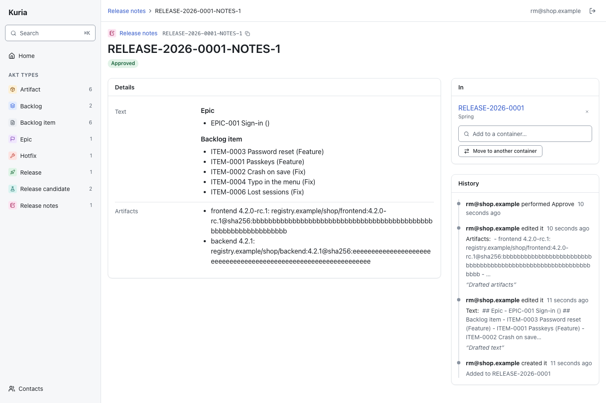
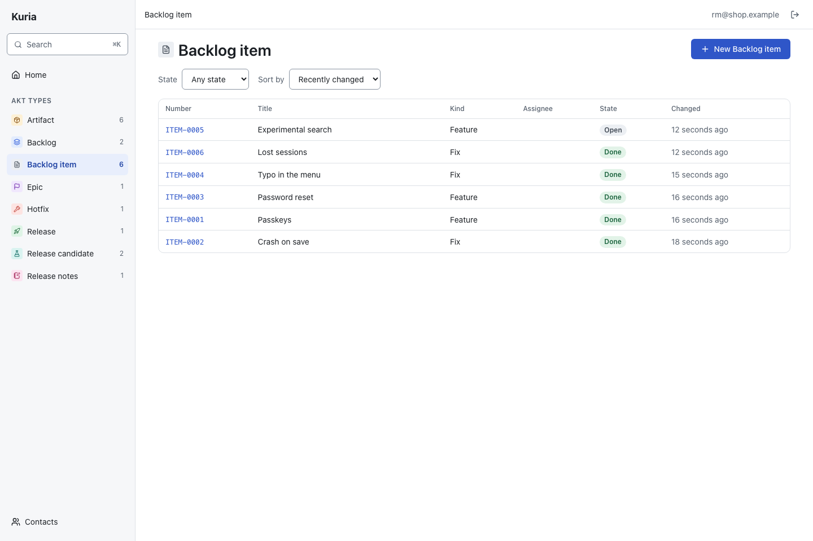
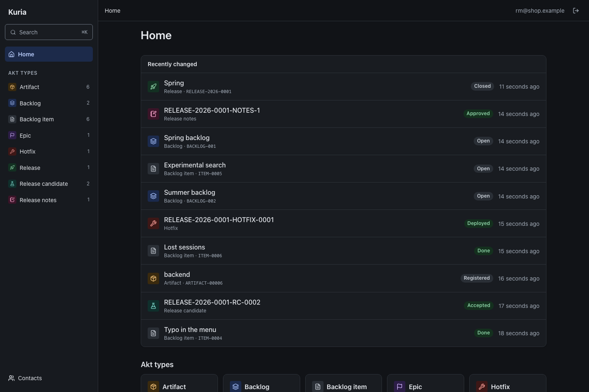
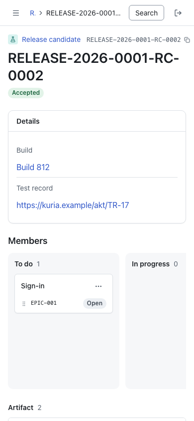

# kuria-web

Kuria's app: a single-page app in SvelteKit (SPA mode, on Vite) that the
server serves from its own origin, and Kuria's login page.



## Screenshots

From the release `mise run e2e:walk` leaves behind, taken by `mise run
e2e:screenshots` ([e2e](../../e2e/README.md)).

|                                                                                      |                                                                                 |
| ------------------------------------------------------------------------------------ | ------------------------------------------------------------------------------- |
|  |                                |
|            |  |
|                                 |                                         |



## Responsibilities

- Building every view from the akt types the server serves; nothing here
  names an akt type ([spec](../../docs/spec/frontend.md)).
- Talking to the server only through GraphQL and the attachment endpoints,
  on its own origin, with the server's session cookie: urql with
  Graphcache, the `changes` subscription over a WebSocket, an akt's live
  draft over another (`/akter/{number}/live`, y-websocket), and sending the
  browser to `/auth/login` when it isn't signed in.
- The login page at `/login`, Konklav's login application
  ([spec](../../docs/spec/login.md)).

## Layout

- [`src/lib/graphql`](src/lib/graphql): `query()` (which asks again only
  when its variables' values change, since variables built from cached
  answers are new objects on every cache update), the client, its cache
  keys, and
  every operation, in `.ts` modules only, so `graphql-codegen` types them.
  The types are generated into `src/lib/graphql/generated` (not checked
  in) from [`schema.graphql`](schema.graphql), which `kuria-server schema`
  prints.
- [`src/lib/design`](src/lib/design): the design tokens (`tokens.css`:
  colours for light and dark, state tones, space, radius, type) and base
  element styles; `theme.ts` lists the colour pairs used together, which
  `theme.test.ts` checks against WCAG 2.2 AA.
- [`src/lib/ui`](src/lib/ui): the components every page builds on:
  `Button`, `IconButton`, `Badge`, `Card`, `Field`, `EmptyState`, `Mono`,
  `Toaster` and `toast()`, and, on Bits UI's accessible primitives, `Menu`
  (behind its own trigger, or opened at an element as a context menu),
  `Dialog` and `Combobox`. Icons from `@lucide/svelte`, bundled. `/design`
  shows them all, in either theme.
- [`src/lib/shell`](src/lib/shell): the app's frame: a sidebar of akt
  types with counts, Home and Contacts (a drawer below 900 pixels), a top
  bar with breadcrumbs (`setCrumbs`), an akt's title under its number,
  which grow as references are followed (`trail.ts`, kept in history
  state, and `akt/following.ts`), the viewer and Sign out, and search
  (`/` or Cmd-K) over akter by number or title.
- [`src/lib/akt`](src/lib/akt): working with akter by their akt types:
  the akt page's parts (`FieldRow`, editing one field in place;
  `TransitionDialog`; `HistoryList`, a timeline from `history.ts`;
  `Members`, the board for the akt types its columns name and a list per
  other akt type, from `members.ts`, reordered by dragging within a
  column or list (`reorder.svelte.ts`) or from each member's menu, and
  dropped on another column to take a transition that leads there;
  `TypeMark`, a type's icon and colour from `identity.ts`; `LinksCard`, an
  akt's links both ways, added by a kind its type declares and removed;
  `Sections`, members in a `sections` field's nested sections, a
  collapsible one closed until opened and kept open while the akt
  reloads, each with its outcome worked out from its members'
  (`sections.ts`, `outcomes.ts`); `VerdictButtons`, a member's assignees
  and their verdicts, and an assignee's own given, changed or taken back
  (`verdicts.ts`), in its section, in a list and on its own page;
  `CopyDialog`, copying an akt with the sections and members chosen;
  `SectionsEditor`, sections edited as an outline, placing members not in
  them; `PeopleSelect`, several people for a `multiple` user field),
  the
  header's title and actions (`header.ts`), sanitized Markdown
  (`markdown.ts`), a `markdown` field as white A4 sheets, split at its
  page breaks, with guides where a sheet would otherwise end (`sheets.ts`,
  styled by `src/lib/design/sheets.css`), pickers that search akter (`pickers.ts`), and
  whom pickers offer (`people.ts`: me, the tenant's users, contacts),
  linking a contact to a user (`contacts.ts`), each field kind's editor,
  input and text (`values.ts`), refusals
  (`errors.ts`), what a change leaves the page with (`editing.ts`), what a
  type contains, drafts and allows (`document.ts`), accessible names
  (`labels.ts`), uploads, and the field editor and display components,
  a shown reference previewing its akt while pointed at or focused
  (`ReferencePreview`, its excerpt from `previews.ts`), and an akt released as
  files shown as the PDF of the version read (`ReleasedPdf`, the field from
  `document.ts`'s `releasedFile`), asked for when releasing.
  Archived akter (`archive.ts`, `app.archive`): lists, search, boards and
  a container's members show live akter, **Show archived** (kept in the
  address as `?archived=all`) adding archived ones, marked "Archived"; a
  container says how many members are archived; an archived akt's page
  says when, by whom or which rule, and why, with **Unarchive** and no
  edit, and a live one offers **Archive…** in its menu, with a reason.
  An akt whose type has live drafts is edited live (`app.live`):
  `live.svelte.ts` opens its Yjs document over y-websocket, says whether
  the person's edits have reached the server (comparing what it has with
  what the server sent), who else is there and why an edit was undone
  (`LivePresence`); its text fields are edited as they are typed, others
  set in its map when saved, checkboxes and verdicts through `editAkt`.
  `editor/live.ts` binds the Markdown editor to a field's `Y.Text`: a
  local change as the one span of Markdown that differs, a remote one by
  re-reading the top-level blocks it touched and keeping the selection
  through Markdown offsets; it also places others' cursors, and binds a
  multiline text's text area.
- [`src/lib/home`](src/lib/home): Home's wording and "My work"
  (`work.ts`: one filtered list per user field and checkbox naming the
  viewer); the page shows the akter changed most recently, "My work", and
  a card per akt type.
- [`src/lib/login`](src/lib/login): the login page's DPoP key, Konklav's
  subject-facing API and the flow for each login request.
- [`src/routes`](src/routes): the pages: akt types, akter by type (a
  table of the presentation's list fields, filtered by state with
  `?state=` and sorted by rank with `?sort=rank`, 50 at a time with
  "Load more"; `paging.ts`; filtered by field values in the address,
  `?where.<field>=`, with `FilterBar` and `filters.ts`), an
  akt, creating one (in containers, with `?in=`), contacts, and `/login`.

Tracey doesn't read `.svelte` files, so the rules the app implements are
implemented, and annotated, in `.ts` modules the components call.

## Running

```sh
mise run web:dev
```

serves the app on <http://localhost:5173>, passing `/graphql`, `/akter`, `/auth`,
`/attachments`, `/export`, `/import`, `/cli`, `/v1`, `/.well-known` and
`/healthz` to `mise run serve` (or `KURIA_DEV_SERVER`). `mise run example
<example>` serves it the same way, against a stack with an example loaded
([`example/`](../../example/README.md)). `mise run web:build` builds it into `build/`, which
the server serves with `KURIA_WEB_DIR`.

After changing the server's schema, run `mise run web:schema`;
`mise run lint` fails while the file differs from what the server prints.

## Testing

```sh
npm test
```

runs the Vitest unit tests; `npm run check` type-checks and
`npm run lint` checks formatting and lints. `mise run lint` and
`mise run test` include them. `mise run e2e` runs the app in a browser
against a seeded Konklav ([`e2e/`](../../e2e/README.md)).

## Traceability

- Specs: [`frontend.md`](../../docs/spec/frontend.md) (`app.*`) and
  [`login.md`](../../docs/spec/login.md) (`login.*`).
